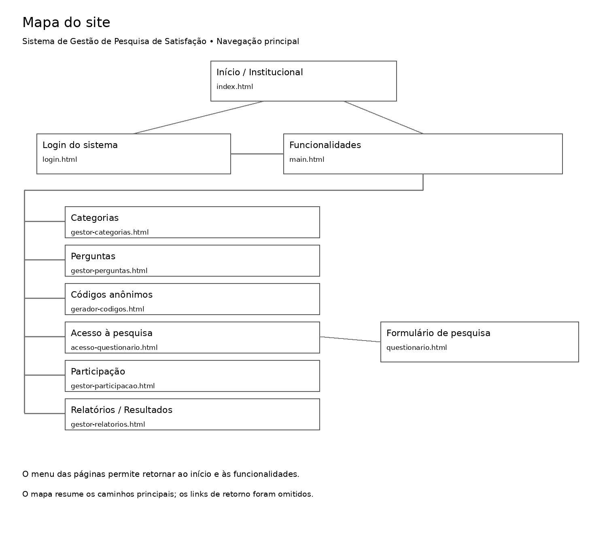
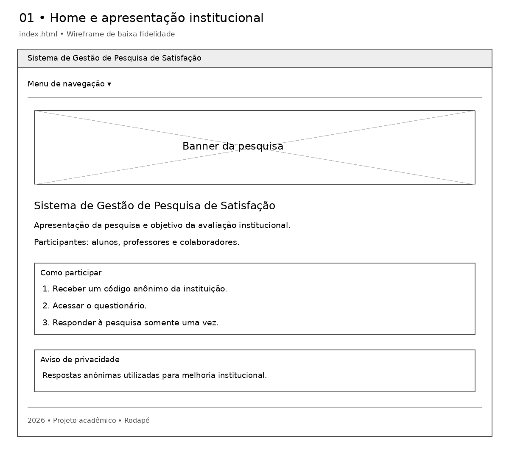
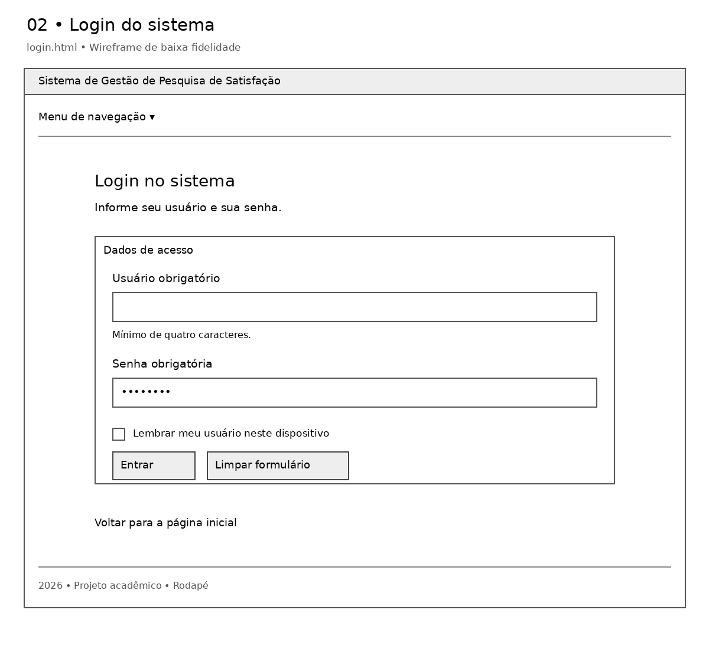
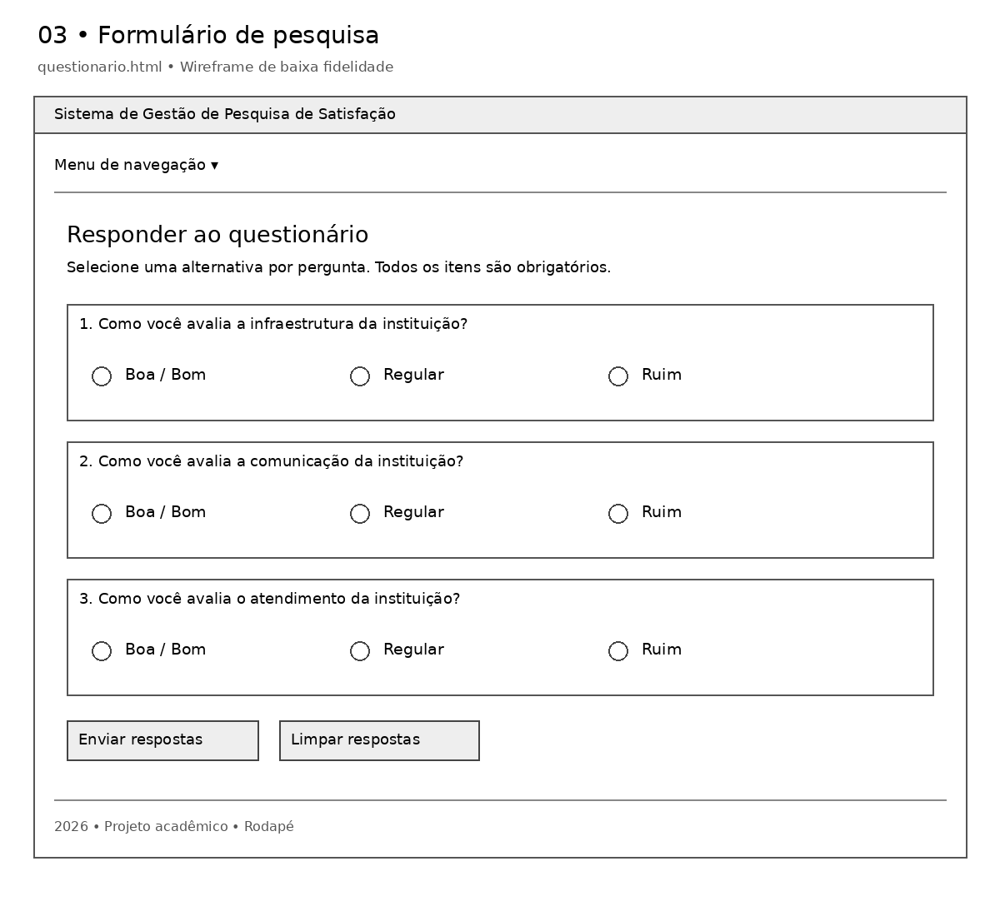
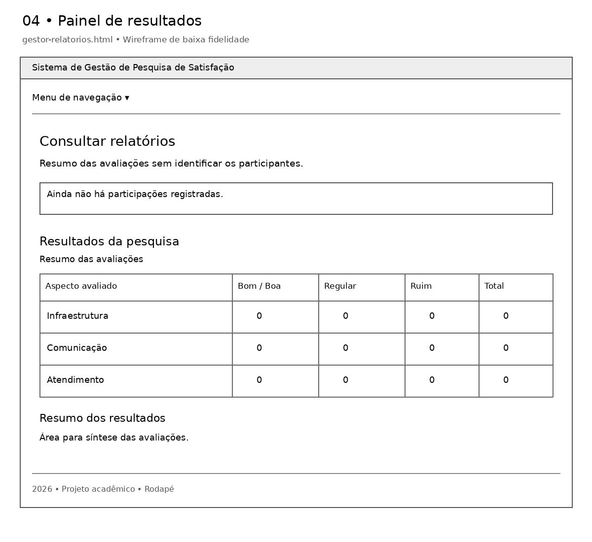
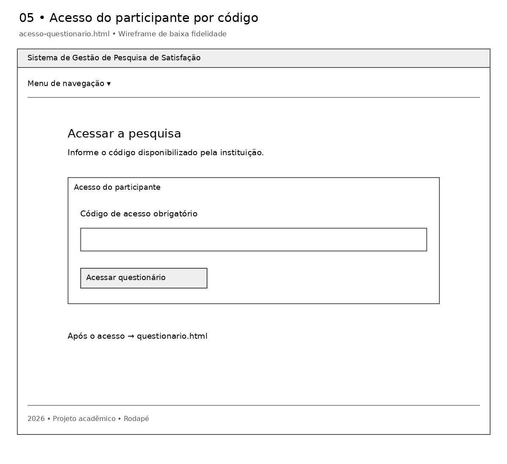

# Arquitetura da informação e wireframes

Sistema de Gestão de Pesquisa de Satisfação.

Rascunhos de baixa fidelidade baseados nas páginas HTML do projeto. Representam a organização dos elementos, sem definir o acabamento visual.

## Mapa do site

## Home e institucional

## Login com senha

## Formulário de pesquisa

## Painel de resultados

## Acesso por código anônimo

Tela complementar presente no projeto, separada do login com senha.

Os formulários HTML são demonstrativos. A validação de login e códigos e o armazenamento das respostas ainda não estão implementados.
