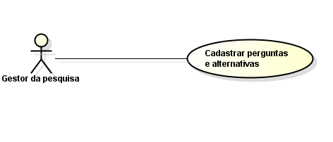
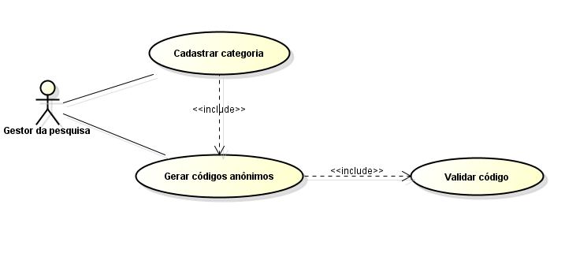
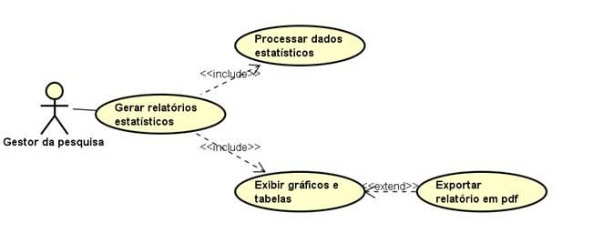

# Requisitos — Sistema de Pesquisas Institucionais

## Objetivo

Permitir a criação, aplicação e análise de pesquisas institucionais, garantindo o anonimato dos participantes e a organização das respostas por categoria.

## Atores

- **Gestor da pesquisa:** organiza as pesquisas, cadastra perguntas, gera códigos de acesso e acompanha os resultados.
- **Participante:** acessa o questionário com um código anônimo e responde às perguntas.

## Requisitos funcionais

- **RF01:** Permitir o cadastro, a consulta, a alteração e a exclusão de pesquisas.
- **RF02:** Permitir o gerenciamento das categorias de participantes.
- **RF03:** Permitir a criação de questionários por categoria.
- **RF04:** Permitir o cadastro de perguntas e alternativas.
- **RF05:** Gerar códigos anônimos de acesso, de uso único, vinculados à categoria.
- **RF06:** Validar o código de acesso e o CAPTCHA antes de liberar o questionário.
- **RF07:** Exibir o questionário correspondente à categoria do código informado.
- **RF08:** Permitir que o participante responda e envie o questionário.
- **RF09:** Registrar as respostas de forma anônima no banco de dados.
- **RF10:** Impedir a reutilização do código após o envio das respostas.
- **RF11:** Permitir o acompanhamento da participação em tempo real.
- **RF12:** Gerar relatórios estatísticos com gráficos e tabelas.
- **RF13:** Permitir a exportação dos relatórios em PDF.
- **RF14:** Permitir o acesso do gestor à área administrativa mediante login e senha.

## Requisitos não funcionais

- **RNF01 — Usabilidade:** Apresentar uma interface simples e amigável.
- **RNF02 — Responsividade:** Adaptar o layout a diferentes tamanhos de tela.
- **RNF03 — Compatibilidade:** Funcionar nos navegadores modernos.
- **RNF04 — Desempenho:** Suportar cerca de 150 acessos simultâneos sem comprometer o funcionamento.
- **RNF05 — Disponibilidade:** Permanecer disponível 24 horas por dia durante o período da pesquisa.
- **RNF06 — Segurança da comunicação:** Utilizar HTTPS com certificado SSL/TLS.
- **RNF07 — Proteção dos códigos:** Gerar códigos por método criptograficamente seguro e armazenar somente seus hashes.
- **RNF08 — Privacidade:** Não registrar IPs nem dados que permitam identificar os participantes.
- **RNF09 — Recuperação:** Realizar backups periódicos do banco de dados.
- **RNF10 — Controle de acesso:** Restringir a área administrativa aos gestores autorizados.

## Diagramas de casos de uso

### Cadastro de perguntas e alternativas

### Gerar códigos anônimos de uso único

### Acessar questionário

### Monitorar participação em tempo real

### Criar relatórios estatísticos

### Manter categorias

